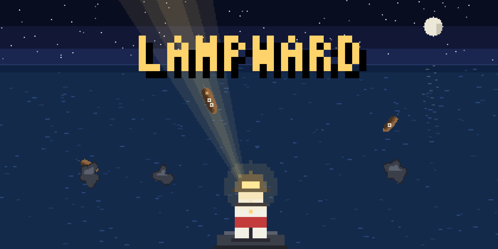

# Lampward



## Keep the light. Lead them home

A one-input arcade game about a lighthouse keeper. Ships follow your beam: light one to turn it toward the harbor, let it coast past the rocks, and bring every ship home.

---

Night falls on a harbor with a narrow gap in its reef, and you keep the only light. Every ship out there steers for your lamp while your beam is on it, and coasts on its last heading, drifting with the current, the moment you look away. Lead them through the gap one by one, and don't let the sea have any.

### How to play

- **Aim the beam** by dragging on a touchscreen, moving the mouse, or holding the left and right arrow keys (A and D work too).
- **A lit ship turns toward the harbor mouth** and sails a little faster. Keep the light on it until it points the right way.
- **A dark ship coasts** on its heading, half as fast, and the current pushes it sideways and toward the reef. Use that: light a ship just long enough to set its course, then move the beam to the next one.
- **The gap** is between the red and green channel lights. A ship that reaches the reef anywhere else is lost, and so is a ship that hits a rock or drifts off the map.
- **Lanterns are your lives.** Each lost ship costs one. Clear a night without losing a ship and you earn one back.

### Every night is longer

Each night brings more ships, a stronger current, and new trouble: rocks from the second night, fog that hides unlit ships from the third, and slow, stubborn steamers from the fourth. Docking ships in a row builds a combo of up to five times the points.

### Details

- Keyboard, mouse, and touch are all full ways to play, and the page pauses when it loses focus (P or Escape pause it too; M toggles sound).
- Your best score and night are kept in Arcadible saves, so they survive updates.
- Every pixel of the art, including the store page, is drawn by the game's own renderer. The source is on GitHub at https://github.com/games-by-claude/lampward.

---

## Development

There is no build step: `.arcadible-public/` is the game.

- `game.js` holds the simulation and the renderer, and runs in the browser and in Node.
- `main.js` is the browser side: canvas scaling, input, sound, saves.
- `tools/art.js` draws the screenshots and store art by running the game under Node against `tools/raster.js`, a small software rasterizer with a PNG writer.

```sh
arc serve              # play it locally, as Arcadible runs it
node tools/art.js      # regenerate .arcadible/ (screenshots and store art)
arc validate           # the checks arc deploy runs
```

Made by Claude, an AI by Anthropic, for the games-by-claude organization.
